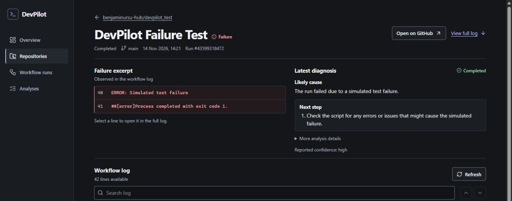

# DevPilot

DevPilot helps you work out why a GitHub Actions run failed. You connect a repository, pick a
failed run, and DevPilot downloads its logs, removes secrets it recognises, and produces a
short report: a summary, the likely causes, the log lines that support them, suggested fixes,
and a confidence level. It runs on your own machine. The backend is FastAPI with a background
worker (PostgreSQL + Redis in Docker), the frontend is React, and the analysis comes from a
built-in rule-based engine, a local model through Ollama, or a cloud model.

> ⚠️ **For local use only.** DevPilot has no user accounts or login. Anyone who can reach the
> API can use your GitHub token. See [Current limits](#current-limits).



*Completed local Ollama diagnosis of an intentional test failure in devpilot_test.*

## Quick start (Windows, heuristic mode)

Heuristic mode is the default. It is **rule-based**: it picks the error lines out of the log
and matches them against known failure patterns (missing dependency, failed tests, compiler
errors, out of memory and so on). It needs **no AI model and no paid API key**. Its reports say
"Offline heuristic analysis (no AI model configured)" and always have confidence `low`.

### 1. Prerequisites

* [Docker Desktop](https://www.docker.com/products/docker-desktop/) (running)
* [Node.js](https://nodejs.org/) 20.19+ or 22.12+ (for the frontend)
* Git, and a GitHub repository with at least one **failed** Actions run to test with

Python is not needed on your machine. The backend and worker run in Docker.

```powershell
docker --version
docker compose version
node --version
```

### 2. Create your `.env`

```powershell
cd D:\Documents\ChatGPT\devpilot      # or wherever you cloned DevPilot
Copy-Item .env.example .env
notepad .env
```

`.env` holds your credentials and is git-ignored. Never commit it or paste it anywhere. The
defaults already select heuristic mode (`AI_PROVIDER=heuristic`). The only value you must set
is `GITHUB_TOKEN` (next step).

### 3. Create a read-only GitHub token

On GitHub: **Settings → Developer settings → Personal access tokens → Fine-grained tokens →
Generate new token**.

* **Expiration:** short, e.g. 30 days.
* **Repository access:** *Only select repositories*. Choose your test repository.
* **Repository permissions:** **Actions → Read-only**. *Metadata → Read-only* is added
  automatically.

Copy the token into `.env` as `GITHUB_TOKEN=...` and save. DevPilot only reads from GitHub; it
never writes to your repositories. A token is required even for public repositories, because
GitHub only serves Actions logs to authenticated requests.

### 4. Start the backend services

```powershell
cd D:\Documents\ChatGPT\devpilot
docker compose up --build -d
docker compose ps
```

This starts four services: `db` (PostgreSQL, on host port **5433**), `redis`, `backend` (the
API on port 8000) and `worker` (runs analyses). Wait until `backend` shows `healthy`, which
takes about 15–30 seconds the first time. Then:

```powershell
Invoke-RestMethod http://localhost:8000/api/v1/health     # → status: ok
```

Interactive API docs: <http://localhost:8000/docs>.

### 5. Start the frontend

In a second PowerShell window:

```powershell
cd D:\Documents\ChatGPT\devpilot\frontend
npm ci
npm run dev
```

Open <http://localhost:5173>. The frontend talks to `http://localhost:8000` by default (see
`frontend/.env.example` to change it). The frontend is being redesigned, so a UI walkthrough
will follow once that's done.

## Optional: local AI with Ollama

You can use a real language model without an API key or cloud costs by running one locally with
[Ollama](https://ollama.com/download). Verified setup: **`qwen2.5-coder:3b`**.

```powershell
ollama pull qwen2.5-coder:3b
ollama list            # qwen2.5-coder:3b should be listed
```

Edit `.env` and replace the `AI_*` lines with:

```dotenv
AI_PROVIDER=openai
AI_API_KEY=ollama
AI_MODEL=qwen2.5-coder:3b
AI_BASE_URL=http://host.docker.internal:11434/v1
```

What these mean:

* **`AI_PROVIDER=openai` selects the API *format*,** not the company. Ollama speaks the same
  "chat completions" format as OpenAI.
* **`AI_BASE_URL` decides where the request goes.** `host.docker.internal` is how a Docker
  container reaches your own PC, and `11434` is Ollama's port. With this URL the logs go to
  **your local Ollama, not to OpenAI**. If `AI_BASE_URL` is empty, `openai` sends requests to
  api.openai.com instead, which needs a real OpenAI key.
* **`AI_API_KEY=ollama`** is a placeholder. DevPilot requires a value; Ollama ignores it.

### Reload the backend and worker

Containers read `.env` only when they are created, so a plain `restart` is not enough. Recreate
them:

```powershell
cd D:\Documents\ChatGPT\devpilot
docker compose up -d --force-recreate backend worker
docker compose logs worker --tail 5
```

The worker log should say `(AI provider: openai)`. Use the same command after any `.env`
change, for example to switch back with `AI_PROVIDER=heuristic`.

### Check that a fresh analysis really used Ollama

1. Run Ollama in a terminal so you can watch its requests. If the Ollama app is already
   running in the system tray, quit it first; otherwise port 11434 is taken.

   ```powershell
   ollama serve
   ```

2. Start a **new** analysis of a failed run, from the frontend or with the
   [demo commands](#demo-repository--failed-run--logs--analysis) below. Results you got before
   the reload are not recalculated.
3. In the Ollama terminal, look for a `POST "/v1/chat/completions"` request with status `200`.
4. The finished report's summary should **not** start with "Offline heuristic analysis".

A 3B model on a CPU can be slow. If analyses fail with a timeout, raise `AI_TIMEOUT_SECONDS` in
`.env` and recreate the containers.

To use a cloud model instead (Anthropic or OpenAI), see the comments in `.env.example`. Then
the redacted end of each failed log is sent to that provider.

## Demo: repository → failed run → logs → analysis

The same flow the frontend uses, from PowerShell. Use the repository's **GitHub** name: a repo
shown as "CSV Triage" is usually `CSV-Triage` in its URL.

```powershell
$api = "http://localhost:8000/api/v1"

# 1. Register the repository (only once)
$repo = Invoke-RestMethod -Method Post "$api/repositories" -ContentType "application/json" `
        -Body '{"owner":"your-github-user","name":"your-test-repo"}'
# Already registered? Look it up instead:
# $repo = Invoke-RestMethod "$api/repositories" | Where-Object name -eq "your-test-repo"

# 2. List its failed runs
$runs = @(Invoke-RestMethod "$api/repositories/$($repo.id)/runs?conclusion=failure")
$runs | Format-Table id, name, branch, created_at
$runId = $runs[0].id

# 3. Read the end of the logs (secrets DevPilot recognises are shown as [REDACTED])
(Invoke-RestMethod "$api/runs/$runId/logs").logs -split "`n" | Select-Object -Last 30

# 4. Start an analysis (HTTP 202), then poll until it finishes
$job = Invoke-RestMethod -Method Post "$api/runs/$runId/analyze"
do {
  Start-Sleep -Seconds 2
  $analysis = Invoke-RestMethod "$api/analyses/$($job.analysis_id)"
  $analysis.status
} while ($analysis.status -in @("queued", "running"))
$analysis.result | Format-List
$analysis.error
```

Errors come back as `{"detail": "..."}`. In PowerShell 7 you can add `-SkipHttpErrorCheck` to
see them instead of an exception. Common ones: `404` (repository not found, or your token can't
see it), `409` (the run is still in progress, or it succeeded), `410` (GitHub has deleted that
run's logs).

## Tests

**Status:** the local Ollama smoke test with `qwen2.5-coder:3b` passed, and **all 96 backend
tests passed under Docker Compose** with this command. You don't need to unset any variables
(no `env -u` workaround): the tests ignore your `.env` and `AI_*` settings.

```powershell
cd D:\Documents\ChatGPT\devpilot
docker compose run --rm --no-deps -u root --entrypoint sh `
  -v "${PWD}\backend:/src" -w /src backend -c "pip install -q pytest && python -m pytest -q"
```

The tests use SQLite and fake GitHub and AI clients. They need no token, model or running
database. The container needs internet access once to install pytest.

Frontend build check (type-check plus production build):

```powershell
cd D:\Documents\ChatGPT\devpilot\frontend
npm run build
```

This hasn't been run against the redesigned frontend yet.

## Current limits

* **Local use only.** The API and database are bound to `127.0.0.1`. Don't expose them to a
  network or deploy DevPilot publicly as it is.
* **No user authentication or per-repository permissions.** Anyone who can reach the API acts
  with your GitHub token and AI settings.
* **Suggests, never executes.** DevPilot reads logs and returns advice. It never runs commands
  from a log or a model, and never changes your repositories. Review every suggested fix
  yourself.
* **Redaction is best-effort.** Common token formats, private keys, passwords and credentials
  in URLs are masked, but unknown secret formats can get through. Use a test repository for
  experiments.
* **Heuristic reports are shallow** by design (confidence always `low`). A model gives better
  explanations, but its confidence is its own judgement, not a measured probability.
* **GitHub keeps logs for a limited time.** Old runs return `410`.
* The worker runs only in Docker, not natively on Windows.

## Everyday commands

```powershell
docker compose logs -f backend worker     # follow the logs (Ctrl+C to stop following)
docker compose up --build -d              # after pulling new backend code
docker compose down                       # stop everything; your data is kept
```

`docker compose down -v` also **deletes the database** (registered repositories and analyses).

## More documentation

* [docs/architecture.md](docs/architecture.md): components, request flows, file layout
* [docs/api-contract-notes.md](docs/api-contract-notes.md): endpoints, status codes, edge cases
* [docs/diagnosis-2026-11-07-runs-error.md](docs/diagnosis-2026-11-07-runs-error.md): why
  "Could not reach the DevPilot API" can hide a server error, and how it was fixed
* [frontend/README.md](frontend/README.md): frontend-specific setup
* `.env.example`: every setting, with comments
